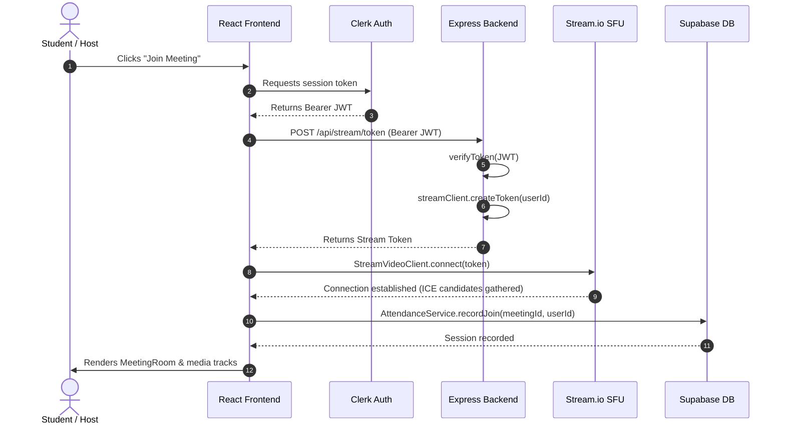

# System Architecture — CollabClass

This document details the real-time collaborative classroom architecture powering video conferencing, interactive whiteboards, code inspection, and AI-assisted classroom management.

---

## 🏛️ High-Level System Topology

```text
                               +--------------------------------------------+
                               |              Clerk Auth Cloud              |
                               | (JWT Session Tokens & User Identity Mgmt)  |
                               +---------------------+----------------------+
                                                     |
                                                     v
+-------------------------------+             +----------------------------------+
|        React 18 Client        |  Auth Token |       Express API Gateway        |
|  (Vite + Tailwind + Radix UI) | ----------> | (Token Minting & Service Proxy)  |
+---------------+---------------+             +--------+----------------+--------+
                |                                      |                |
                | Media & SFU Signaling                | Stream Token   | LLM Completion
                v                                      v                v
+---------------+---------------+             +--------+-------+  +-----+--------+
|      Stream.io Video SFU      |             |   Stream SDK   |  |  Groq Cloud  |
|  (Global Selective Forwarder) |             |  (Token Mint)  |  |  (Llama 3.3) |
+---------------+---------------+             +----------------+  +--------------+
                |
                | Attendance & Session Logs
                v
+---------------+---------------+
|       Supabase Cloud DB       |
|    (PostgreSQL / PostgREST)   |
+-------------------------------+
```

---

## 🧩 Architectural Components

### 1. Client Presentation Tier (`frontend/`)
- **Core Framework:** React 18 with Vite build tooling and TypeScript.
- **Styling Architecture:** Tailwind CSS utility styling, glassmorphism overlays, custom keyframe animation engine, and Radix UI primitives.
- **Conferencing Layer:** Powered by `@stream-io/video-react-sdk`, providing declarative Call Layouts (`SpeakerLayout`, `PaginatedGridLayout`), screen-sharing tracks, participant state hooks, and device controls.
- **Interactive Canvas Engine:** Integrated with `@excalidraw/excalidraw` for vector sketching, wireframing, and diagramming.
- **Code Explorer:** Combines GitHub REST API data with `@shikijs` syntax highlighting for in-meeting code reviews across 30+ languages.
- **Auth Provider:** `@clerk/clerk-react` managing user sessions, avatars, and short-lived JWT tokens.

---

### 2. Application & API Gateway (`backend/`)
- **Runtime:** Node.js 20+ with Express and TypeScript.
- **Security & Middleware:**
  - `cors`: Strict origin validation allowlisting local development ports (`5173`, `3000`, `3001`) and production deployments (`collabnclass.vercel.app`, `collabclass.vercel.app`).
  - `verifyAuth`: Validates Clerk Bearer JWT tokens using `@clerk/clerk-sdk-node` prior to granting service access.
- **Service Endpoints:**
  - `POST /api/stream/token`: Mints authenticated Stream call tokens for verified Clerk users with 1-hour expiration and 60-second clock skew tolerance.
  - `DELETE /api/stream/recordings/:id`: Manages call recording deletion.
  - `GET /api/github/repo/*`: Proxies GitHub repository exploration requests with personal access token pooling to avoid rate-limiting.
  - `POST /api/chatbot`: Streams LLM responses from Groq's high-speed inference engine (`llama-3.3-70b-versatile`).

---

### 3. Media & Real-Time Delivery (Stream.io SFU)
- **Architecture:** Selective Forwarding Unit (SFU) network rather than peer-to-peer mesh, drastically reducing bandwidth and CPU consumption on student devices.
- **Signaling & State:** Participant audio/video tracks, layout negotiation, and custom in-meeting events (chat messages, meeting metadata) are coordinated via Stream's WebRTC infrastructure with automatic bitrate switching.

---

### 4. Persistence & Database Tier (Supabase)
- **Engine:** PostgreSQL managed via Supabase PostgREST.
- **Attendance Ledger (`meeting_attendance` table):**
  - Logs student session join timestamps (`joined_at`), departure timestamps (`left_at`), user IDs, and meeting IDs.
  - Queried via `@supabase/supabase-js` using atomic `.maybeSingle()` lookups to prevent duplicate or conflicting session states.

---

## 🔄 Core Data & Execution Flows


